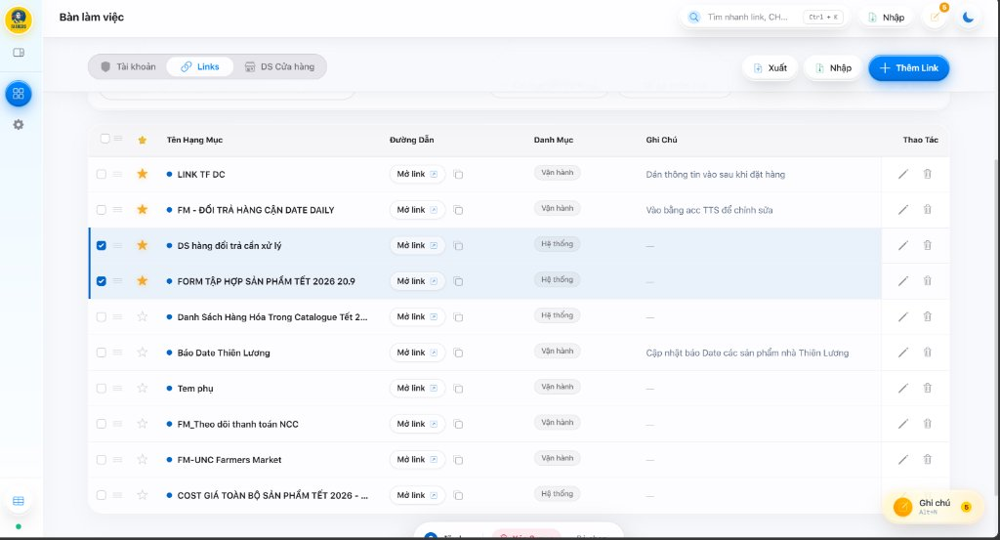
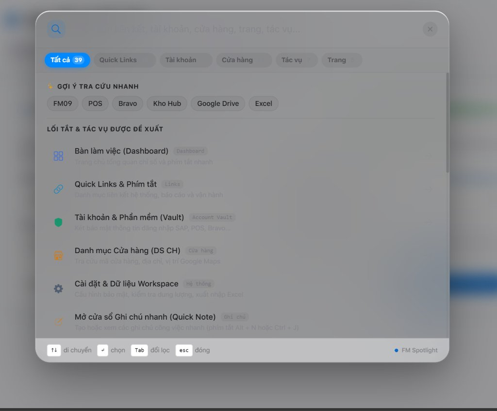
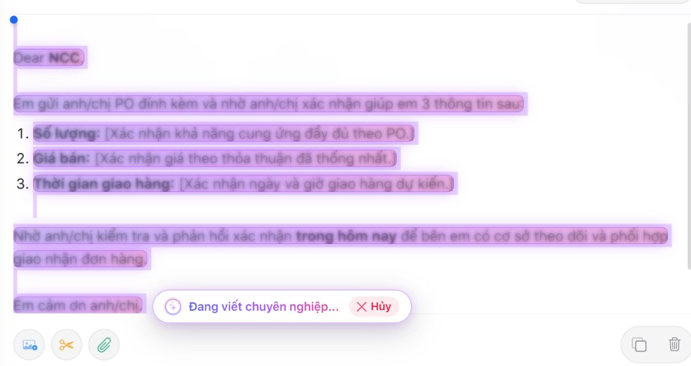
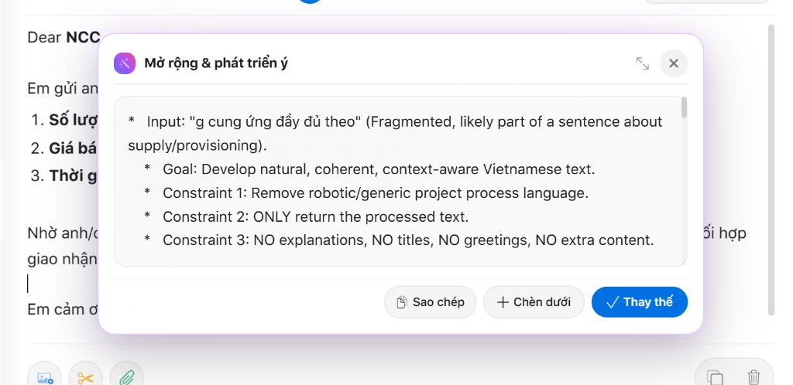
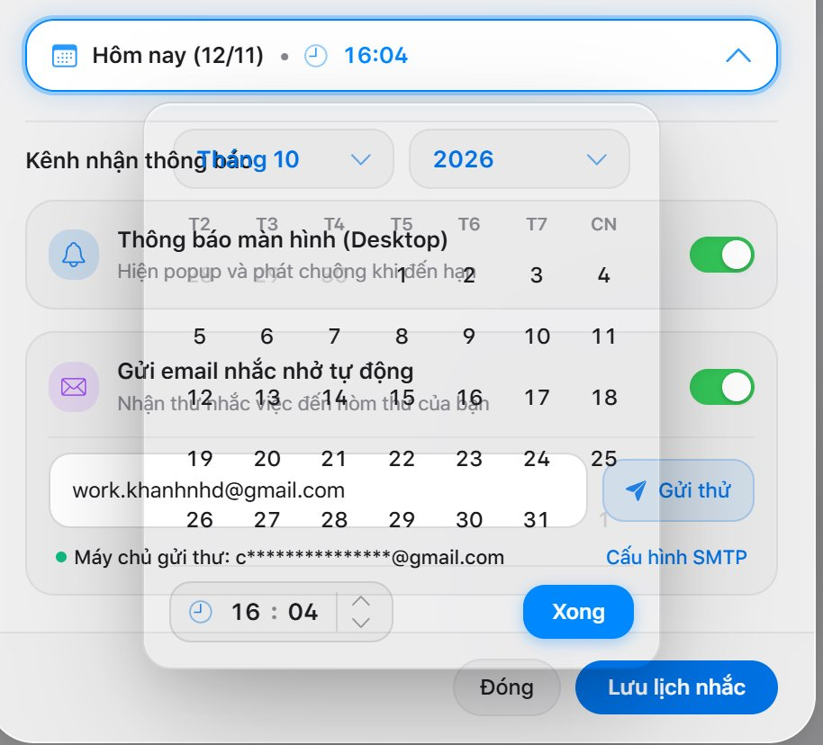
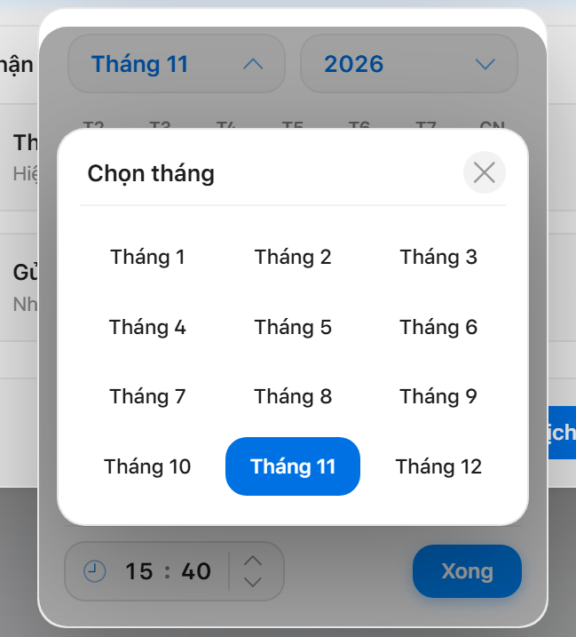
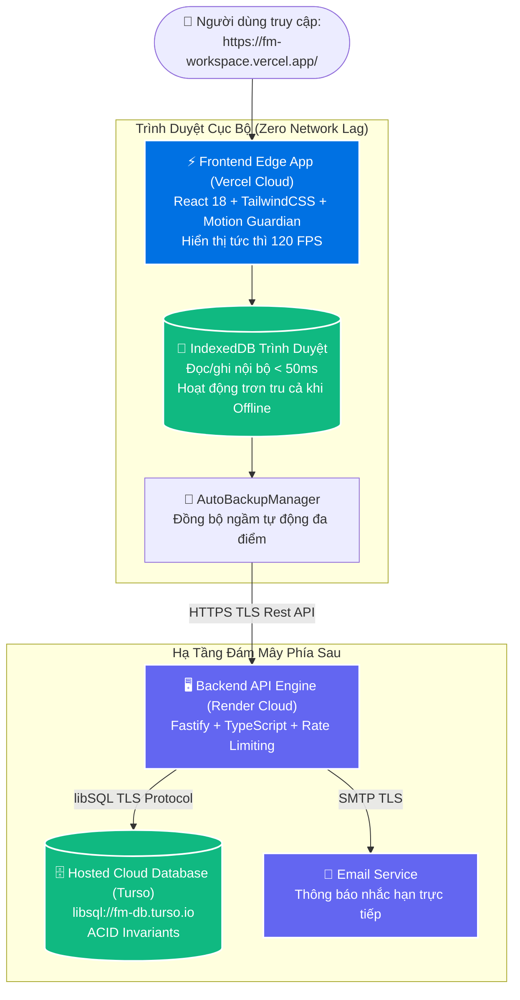

<div align="center">

  

  # 🌾 FM WORKSPACE
  ### Trợ Lý Thu Mua & Quản Trị Tác Nghiệp Thông Minh • Farmers Market Việt Nam

  <p align="center">
    <b>Không gian số all-in-one thế hệ mới — Phong cách thiết kế Apple Liquid Glass 120 FPS</b><br>
    <i>Tích hợp Trợ lý Trí tuệ Nhân tạo AI, Tra cứu Spotlight đa năng, Math Notes, Két bảo mật Vault & Tự động nhắc hẹn đa kênh</i>
  </p>

  <p align="center">
    <a href="https://fm-workspace.vercel.app/" target="_blank">
      
    </a>
    
    
    
    
    
  </p>

  <p align="center">
    <a href="#-tổng-quan-giao-diện--trải-nghiệm-người-dùng">Khám Phá Giao Diện</a> •
    <a href="#-tính-năng-nổi-bật">Tính Năng Nổi Bật</a> •
    <a href="#-kiến-trúc-đám-mây--bảo-mật">Kiến Trúc & Bảo Mật</a> •
    <a href="#-phím-tắt-tiện-dụng">Phím Tắt</a> •
    <a href="#-hướng-dẫn-cài-đặt">Cài Đặt</a>
  </p>

</div>

---

## 🌟 Tổng Quan Giao Diện & Trải Nghiệm Người Dùng

FM Workspace kết hợp hoàn hảo giữa thẩm mỹ tinh tế của **Apple macOS & iOS Liquid Glass** với hiệu năng thực thi cực nhanh (**Sub-50ms**). Không cần cài đặt phần mềm nặng máy, người dùng truy cập trực tiếp trên mọi nền tảng hoặc ghim PWA vào màn hình chính.

```
┌──────────────────────────────────────────────────────────────────────────────────┐
│  FM WORKSPACE ECOSYSTEM                                                         │
├─────────────────┬───────────────────┬──────────────────────┬─────────────────────┤
│ 🔗 Quick Links  │ 🔐 Account Vault  │ 🏪 Store Directory   │ 📝 AI Quick Notes   │
│ Hệ thống liên   │ Két mật khẩu mã   │ Danh bạ cửa hàng, mã │ Math Notes, OCR ảnh,│
│ kết nghiệp vụ   │ hóa, tự hủy clip  │ kho, vị trí GPS Maps │ AI Writing Tools    │
└─────────────────┴───────────────────┴──────────────────────┴─────────────────────┘
```

---

## 📸 Bộ Sưu Tập Giao Diện & Tính Năng Trọng Tâm

### 1. Bàn Làm Việc Tác Nghiệp Đồng Bộ (Unified Workspace)
> Bố cục trực quan, lọc tức thì theo nhóm danh mục, đánh dấu yêu thích ⭐, chọn hàng loạt xử lý nhanh và kéo thả sắp xếp thứ tự linh hoạt.

<div align="center">
  
  <p><i>Giao diện quản lý Danh mục liên kết hệ thống, Form sản phẩm Tết và Báo date vận hành hàng ngày</i></p>
</div>

* ⚡ **Phản hồi tức thì**: Bảng dữ liệu hỗ trợ cuộn mượt mà 120 FPS, loại bỏ hiện tượng trễ khung hình.
* 🏷️ **Phân loại 2 nhóm thông minh**: Nhóm Hệ thống & Nhóm Vận hành giúp kiểm soát luồng công việc rõ ràng.
* 📋 **Thao tác 1-Click**: Mở liên kết trực tiếp, sao chép nhanh đường dẫn và chỉnh sửa trực quan.

---

### 2. Tìm Kiếm Toàn Năng FM Spotlight (`Ctrl + K`)
> Tra cứu tức thời mọi dữ liệu từ tài khoản, liên kết, danh bạ cửa hàng cho đến các trang hệ thống chỉ trong một phím bấm.

<div align="center">
  
  <p><i>FM Spotlight gợi ý thông minh, tra cứu mã cửa hàng FM09, POS, Bravo, Google Drive trong &lt; 10ms</i></p>
</div>

* 🔎 **Tìm kiếm đa tầng**: Hỗ trợ lọc theo danh mục (`Tab`), gợi ý từ khóa phổ biến và lưu lịch sử tra cứu gần nhất.
* ⌨️ **Điều hướng bàn phím hoàn chỉnh**: Di chuyển `↑` `↓`, chọn `Enter`, chuyển tab bộ lọc `Tab`, đóng nhanh `Esc`.
* 🛡️ **Giao diện kính mờ Liquid Glass**: Khử hoàn toàn hiện tượng lọt sáng và chồng chữ, hiển thị sắc nét ở cả chế độ Sáng (Light) và Tối (Dark).

---

### 3. Ghi Chú Nhanh Math Notes & Quét Văn Bản AI (Quick Notes)
> Cửa sổ ghi chú nổi tự do tích hợp máy tính tự động theo thời gian thực (Math Solver) và hiệu ứng quét chữ Apple Intelligence.

<div align="center">
  
  <p><i>Hiệu ứng dải lụa phát quang Apple Intelligence quét dòng chữ mượt mà khi xử lý viết chuyên nghiệp</i></p>
</div>

* 🧮 **Math Notes trong dòng**: Tự động tính nhẩm ngay khi gõ phép tính kết thúc bằng dấu `=` (ví dụ: `150 * 32000 =` ➔ `4,800,000`).
* 🎨 **Hiệu ứng dải lụa Shimmer Wave**: Chuyển động quét chữ tím pastel mượt mà, định vị chính xác từng dòng văn bản mà không che mờ nội dung.
* 🖼️ **Trình sửa ảnh chuyên nghiệp (Image Editor)**: Cắt cúp ảnh tỷ lệ vàng (Crop 3x3 Grid), xoay ảnh, vẽ chú thích và nút xoá nhanh Liquid Glass 28px.

---

### 4. Bộ Công Cụ Viết AI Thương Mại (Writing Tools Intelligence)
> Tối ưu hóa toàn diện 9 tác vụ biên soạn nội dung, giao tiếp đối tác và xử lý email thu mua chuẩn mực công vụ.

<div align="center">
  
  <p><i>Menu Writing Tools dạng capsule thông minh, hỗ trợ đa dạng phương thức xử lý văn bản</i></p>
</div>

| Tính Năng | Mục Tiêu & Cơ Chế Hoạt Động |
|---|---|
| **📄 Tóm tắt nội dung** | Chắt lọc thông tin cốt lõi (Ai, làm gì, khi nào, số lượng, lưu ý chính), bỏ qua chi tiết thừa |
| **📑 Rút ra ý chính** | Liệt kê các luận điểm mấu chốt được đánh số thứ tự rõ ràng, ngắn gọn và mạch lạc |
| **💼 Viết chuyên nghiệp** | Tái cấu trúc email/văn bản sang chuẩn mực thương mại trang trọng, gửi nhà cung cấp được ngay |
| **✂️ Viết ngắn gọn, súc tích** | Tối giản câu từ, lược bỏ từ đệm nhưng bảo toàn 100% bản chất thông điệp truyền đạt |
| **✅ Sửa chính tả & câu từ** | Chuẩn hóa dấu câu, ngắt nhịp và chính tả tiếng Việt tự nhiên, không làm đổi ý văn |
| **💡 Mở rộng & phát triển ý** | Bổ sung ngữ cảnh thực tế theo đặc thù chuỗi thu mua nông sản & bán lẻ |
| **☑️ Liệt kê việc cần làm** | Tự động chuyển đổi đoạn văn bản thành checklist hành động `- [ ]` có thể đánh dấu hoàn thành |
| **🌐 Dịch thuật song ngữ** | Dịch hai chiều Anh ⇄ Việt chuẩn thuật ngữ thu mua, logistics và hợp đồng thương mại |

---

### 5. Hẹn Giờ Nhắc Việc Đa Kênh & Bộ Chọn Ngày Giờ Apple (Date Picker)
> Nhắc hẹn chính xác đến từng phút qua âm thanh chuông Apple Chime, thông báo màn hình máy tính và email tự động.

<div align="center">
  
  <p><i>Bộ chọn ngày giờ kiểu Apple với capsule chỉnh giờ [ ⏰ 16 : 05 ▲/▼ ] và phím tắt tiện lợi</i></p>
</div>

* 🔔 **Nhắc hẹn 3 tầng độc lập**:
  1. **Chuông báo âm thanh**: Âm sắc Apple Chime du dương, không gây giật mình.
  2. **Thông báo Desktop**: Hiển thị popup góc màn hình kể cả khi đang làm việc trên tab khác.
  3. **Email tự động**: Gửi email cảnh báo công việc đến hòm thư đã cấu hình SMTP cá nhân.
* 📅 **Gợi ý lịch thông minh**: Đặt nhanh "Tối nay (18:00)", "Sáng mai (09:00)", "Chiều mai (14:00)", "Sau 1 giờ nữa".

---

### 6. Pop-up Con Trong Suốt Đa Tầng (Multi-layer Glass Sub-picker)
> Thiết kế phân cấp chiều sâu với lớp mờ hậu cảnh `backdrop-blur-md` và hộp thoại nổi sắc nét.

<div align="center">
  
  <p><i>Pop-up chọn tháng và năm dạng kính mờ tinh tế, viền phản quang bo tròn chuẩn tỉ lệ vàng</i></p>
</div>

---

## ⚡ Kiến Trúc Đám Mây & Bảo Mật (Zero-Cost Cloud Architecture)



### 🔒 Tiêu Chuẩn Bảo Mật Cấp Doanh Nghiệp
- **Két mã hóa Vault**: Tự động dọn dẹp bộ nhớ tạm (Clipboard) sau **45 giây** kể từ khi sao chép mật khẩu.
- **Mã hóa file sao lưu (.fmbackup)**: Dữ liệu được bảo vệ bằng thuật toán mã hóa đối xứng **AES-GCM-256** kết hợp mã băm kiểm tra tính toàn vẹn **SHA-256**.
- **Khóa bảo vệ không gian làm việc (Privacy Shield)**: Tính năng mã PIN 6 số với cơ chế tự khóa sau thời gian không hoạt động (15/30 phút).

---

## ⌨️ Bảng Phím Tắt Tiện Dụng

| Phím tắt | Tác vụ thực hiện | Vị trí áp dụng |
|---|---|---|
| <kbd>Ctrl</kbd> + <kbd>K</kbd> | Bật thanh tìm kiếm toàn năng FM Spotlight | Bất kỳ đâu trên ứng dụng |
| <kbd>Alt</kbd> + <kbd>N</kbd> / <kbd>Ctrl</kbd> + <kbd>J</kbd> | Mở hoặc thu nhỏ cửa sổ Ghi chú nhanh (Quick Note) | Bất kỳ đâu trên ứng dụng |
| <kbd>Ctrl</kbd> + <kbd>\</kbd> | Thu gọn hoặc mở rộng thanh điều hướng Sidebar | Toàn hệ thống |
| <kbd>Phép tính</kbd> + <kbd>=</kbd> | Tính toán tự động và in kết quả tức thì | Bên trong nội dung ghi chú |
| <kbd>Tab</kbd> / <kbd>Shift</kbd> + <kbd>Tab</kbd> | Chuyển đổi nhanh qua lại giữa các bộ lọc tìm kiếm | Hộp thoại Spotlight |
| <kbd>Esc</kbd> | Đóng nhanh cửa sổ nổi, modal hoặc popover đang hiển thị | Toàn hệ thống |

---

## 🚀 Hướng Dẫn Cài Đặt Dành Cho Lập Trình Viên

### 1. Yêu cầu tiên quyết
- **Node.js**: Phiên bản 18.x trở lên.
- **npm**: Phiên bản 9.x trở lên.

### 2. Thiết lập dự án cục bộ
```bash
# Clone kho lưu trữ
git clone https://github.com/gochee-nhdk/fm-workspace.git
cd fm-workspace

# Cài đặt toàn bộ dependencies cho Client & Server
npm run setup

# Khởi chạy đồng thời Frontend và Backend trong môi trường dev
npm run dev
```

### 3. Kiểm thử & Đóng gói sản phẩm
```bash
# Chạy toàn bộ bộ kiểm thử tự động (Unit, Security, Business Logic)
npm test

# Kiểm thử riêng biệt cho phía giao diện Client
npm --prefix client test -- --run

# Biên dịch gói sản xuất tối ưu (Vite Production Build)
npm --prefix client run build
```

---

<div align="center">
  <p><b>FM Workspace</b> — Phát triển với tình yêu và sự tận tâm dành cho đội ngũ Vận hành & Thu mua <b>Farmers Market</b>.</p>
  <p>© 2026 Farmers Market Việt Nam. Bản quyền được bảo lưu.</p>
</div>
