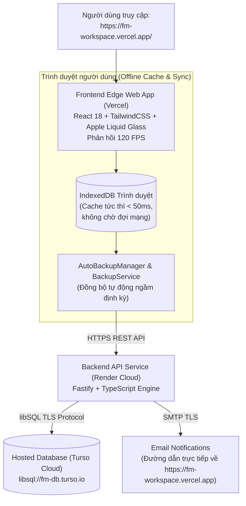

# 🌾 FM Workspace — Trợ Lý Thu Mua Farmers Market

<p align="center">
  <a href="https://fm-workspace.vercel.app/">
    
  </a>
  
  
  
  
</p>

> Không gian làm việc, quản lý thu mua & tác nghiệp thông minh dành cho đội ngũ Farmers Market Việt Nam — thiết kế theo tiêu chuẩn thẩm mỹ **Apple Liquid Glass (macOS 26 & iPadOS 18)**, vận hành trực tuyến liên tục tại: **[https://fm-workspace.vercel.app/](https://fm-workspace.vercel.app/)**.

---

## 🌐 Truy Cập Trực Tuyến & Cài Đặt PWA (Không Cần Tải App)

Hệ thống được triển khai trên nền tảng đám mây hiện đại, không cần cài đặt phần mềm exe, không chiếm tài nguyên máy và đồng bộ mượt mà:

### 1. Truy cập trực tiếp qua trình duyệt
Mở liên kết: **[https://fm-workspace.vercel.app/](https://fm-workspace.vercel.app/)** trên bất kỳ trình duyệt nào (Google Chrome, Microsoft Edge, Safari, Firefox).

### 2. Cài đặt dạng Web App (PWA) 1-Click
Bạn có thể ghim ứng dụng vào Taskbar / Desktop hoặc màn hình điện thoại mà không cần tải file `.exe`:
* **Trên Google Chrome / Microsoft Edge:** Nhấp vào biểu tượng **"Cài đặt FM Workspace"** (App Available) ở góc phải thanh địa chỉ URL.
* **Trên macOS Safari:** Chọn **Tệp (File)** &rarr; **Thêm vào Dock (Add to Dock)**.
* **Trên iPhone / iPad (Safari):** Bấm nút **Chia sẻ (Share)** &rarr; chọn **"Thêm vào Màn hình chính" (Add to Home Screen)**.

---

## ⚡ Kiến Trúc Đám Mây Tối Ưu (Zero-Cost Cloud Architecture)



---

## ✨ Tính Năng Nổi Bật

### 📝 Apple Math Notes & Ghi Chú Nhanh
- Tự động tính toán tức thì khi gõ phép tính kết thúc bằng dấu `=` (ví dụ: `15 * 45000 =` &rarr; `675,000`).
- Cửa sổ nổi tự do (Free Floating Window) chuẩn **120 FPS**, không giật lag.
- Interactive Checklist phân tách độc lập, hỗ trợ đính kèm hình ảnh và xem trước tệp tài liệu.
- Bộ chọn ngày giờ nhắc việc Apple Date Picker thanh lịch.

### 🔐 Két Mật Khẩu Tác Nghiệp (Account Vault)
- Lưu trữ và phân loại tài khoản: SAP, POS, Bravo, KiotViet, Portal Nhà Cung Cấp.
- **Tự động làm sạch Clipboard sau 45 giây** — Đảm bảo an toàn thông tin mật khẩu.
- Kéo thả sắp xếp thứ tự và phân nhóm cửa hàng trực quan.

### 🔍 Tìm Kiếm Đa Năng Spotlight (`Ctrl + K`)
- Tìm kiếm tức thời liên kết, tài khoản, cửa hàng (`FM09`, `FM18`) trong < 10ms.
- Nhấn phím **Tab** để chuyển đổi nhanh các phạm vi tìm kiếm.

### 🤖 Trợ Lý Soạn Thảo AI (Google Gemini)
- 9 công cụ xử lý văn bản thương mại: Tóm tắt văn bản, Rút ra hành động to-do, Soạn email nhà cung cấp, Dịch thuật chuyên ngành...

### 💾 Sao Lưu Toàn Diện (.fmbackup) & Tự Động Đồng Bộ
- Dữ liệu hiển thị tức thì từ bộ nhớ IndexedDB của trình duyệt (< 50ms khi mở web).
- Tự động sao lưu lên máy chủ đám mây khi có thay đổi dữ liệu hoặc chuyển tab.
- Xuất file sao lưu toàn diện `.fmbackup` được mã hóa chuẩn **AES-GCM-256** và kiểm tra toàn vẹn **SHA-256**.

---

## 🔑 Phím Tắt Phổ Biến

| Phím tắt | Chức năng |
|---|---|
| `Ctrl + K` | Mở tìm kiếm nhanh Spotlight |
| `Alt + N` / `Ctrl + J` | Bật / Tắt cửa sổ Ghi chú nhanh |
| `Ctrl + \` | Mở rộng / Thu gọn thanh điều hướng Sidebar |
| Gõ phép tính + `=` | Tự động tính nhẩm ngay trong dòng ghi chú |
| `Esc` | Đóng nhanh cửa sổ / hộp thoại đang mở |

---

## 🛠️ Dành Cho Lập Trình Viên (Developer Setup)

```bash
# 1. Clone mã nguồn
git clone https://github.com/gochee-nhdk/fm-workspace.git
cd fm-workspace

# 2. Cài đặt phụ thuộc cho cả client & server
npm run setup

# 3. Chạy môi trường phát triển cục bộ
npm run dev

# 4. Kiểm thử
npm test
npm --prefix client test

# 5. Biên dịch sản phẩm
npm run build
```

---

## 📄 Giấy Phép & Bản Quyền

Phát triển bởi đội ngũ công nghệ thông tin nội bộ cho hệ thống chuỗi cửa hàng thực phẩm sạch **Farmers Market Việt Nam**.  
Thiết kế hướng tới trải nghiệm người dùng cao cấp, ổn định, bảo mật và hiện đại. 🌾
