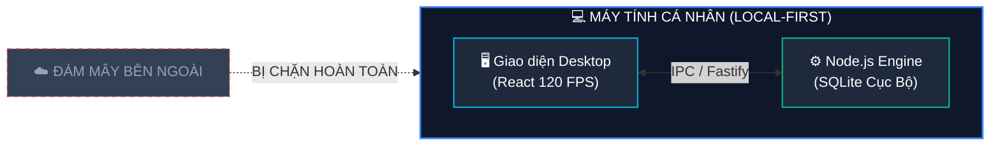

# 🌾 FM Workspace — Trợ Lý Thu Mua Farmers Market

<p align="center">
  
  
  
  
  
</p>

> Hệ thống quản lý thu mua, tính toán thông minh & quản trị tác nghiệp nội bộ — thiết kế theo tiêu chuẩn **Apple Liquid Glass (macOS 26 & iPadOS 18)**, chạy hoàn toàn **cục bộ** (Local-First), không cần Internet.

---

## 🚀 Cài Đặt Nhanh 1 Lệnh Duy Nhất (1-Command Terminal Setup)

Chỉ cần mở Terminal / PowerShell, dán đúng **1 dòng lệnh duy nhất** dưới đây rồi nhấn Enter — hệ thống sẽ tự động tải mã nguồn về máy, cho phép chọn ổ đĩa cài đặt trực quan, thiết lập CSDL SQLite, tự động tạo phím tắt Desktop và khởi chạy ngay trên trình duyệt mặc định:

### 🪟 Windows (Mở PowerShell):
```powershell
irm https://raw.githubusercontent.com/gochee-nhdk/fm-workspace/main/scripts/install.ps1 | iex
```

### 🍎 macOS / Linux (Mở Terminal):
```bash
curl -fsSL https://raw.githubusercontent.com/gochee-nhdk/fm-workspace/main/scripts/install.sh | bash
```

---

## ⚡ Hoặc Cài Đặt 1-Click Khi Đã Tải Mã Nguồn Về Máy (Offline / Manual)

Chỉ cần tải mã nguồn (code) từ GitHub về máy tính, chạy script cài đặt 1 lần duy nhất — hệ thống sẽ **tự động kích hoạt, tạo biểu tượng Desktop và sẵn sàng mở ngay trên trình duyệt mặc định**:

### 🪟 Dành cho Windows:
```cmd
1. Tải về và giải nén mã nguồn từ GitHub
2. Nhấp đúp vào: CAI_DAT_APP.bat (hoặc CAI_DAT.bat)
3. Chờ 1-2 phút hoàn tất cài đặt
4. Biểu tượng [FM Workspace] sẽ tự động xuất hiện trên màn hình Desktop
```
* **Mở app bất kỳ lúc nào:** Nhấp đúp vào biểu tượng trên Desktop hoặc nhấn phím tắt toàn cục **`Ctrl + Alt + F`**.

---

### 🍎 Dành cho macOS (và Linux):
```bash
# Mở Terminal trong thư mục mã nguồn và chạy:
chmod +x install.sh && ./install.sh
```
* Script sẽ tự động cài đặt môi trường, biên dịch web app và **tự động tạo biểu tượng ứng dụng `FM Workspace` ngay trên màn hình Desktop của Mac**.
* **Mở app bất kỳ lúc nào:** Nhấp đúp vào biểu tượng **FM Workspace** trên Desktop của Mac hoặc chạy `./start.sh`.

---

## 🚀 Khởi Động & Quản Lý

| Thao tác | Windows | macOS / Linux |
|---|---|---|
| **Cài đặt lần đầu** | `CAI_DAT_APP.bat` | `./install.sh` |
| **Mở ứng dụng** | Nhấp đúp Desktop hoặc `Ctrl + Alt + F` | Nhấp đúp Desktop hoặc `./start.sh` |
| **Dừng ứng dụng** | `DUNG_APP.bat` | `./stop.sh` |
| **Sao lưu dữ liệu** | `SAO_LUU_DU_LIEU.bat` | Thư mục `server/data/app.db` |


> App tự động kiểm tra xem server đang chạy chưa. Nếu chưa → tự khởi động, chờ ready, rồi mở trình duyệt mặc định.

---

## ✨ Tính Năng Nổi Bật

### 📝 Apple Math Notes & Ghi Chú Nhanh
- Gõ bất kỳ phép tính kết thúc bằng `=` → Tự động ra kết quả ngay trong ghi chú
- Cửa sổ nổi tự do (Free Floating Window) — Di chuyển mượt mà **120 FPS**
- Interactive Checklist, đính kèm file & ảnh, xem trước PowerPoint (.pptx)
- Lịch nhắc nhở thông minh với bộ chọn ngày giờ Apple Liquid Glass

### 🔐 Két Mật Khẩu Tác Nghiệp (Account Vault)
- Quản lý tập trung mọi tài khoản nội bộ: SAP, POS, Bravo, KiotViet, Portal nhà cung cấp...
- **Tự hủy Clipboard sau 45 giây** — Bảo vệ chống đánh cắp dữ liệu
- Kéo thả (Drag & Drop) sắp xếp thứ tự ưu tiên

### 🔍 Tìm Kiểm Đa Năng Spotlight (`Ctrl+K`)
- Tìm nhanh liên kết, tài khoản, mã cửa hàng (`FM09`, `FM18`) trong <10ms
- Dùng phím **Tab** để chuyển đổi phạm vi lọc tức thì

### 🤖 Trợ Lý Soạn Thảo AI (Google Gemini)
- 9 công cụ xử lý ngôn ngữ: Tóm tắt, Rút ra ý chính, Viết lại chuyên nghiệp, Dịch thuật thương mại...

### 💾 Sao Lưu & Phục Hồi (.fmbackup)
- Xuất toàn bộ dữ liệu ra 1 file duy nhất, xác thực bằng **SHA-256**
- Nhập lại bất kỳ lúc nào, không mất dữ liệu

---

## 🛡️ Kiến Trúc: Local-First & Zero-Cloud Leak



- **100% Cục bộ**: Ghi chú, tài khoản, mật khẩu lưu trong SQLite (`server/data/`)
- **Offline hoàn toàn**: Không cần Internet sau khi cài đặt
- **Không phụ thuộc đám mây**: Tránh hoàn toàn nguy cơ rò rỉ dữ liệu

---

## 🔑 Phím Tắt Phổ Biến

| Phím tắt | Chức năng |
|---|---|
| `Ctrl + Alt + F` | Mở/Khởi động FM Workspace từ Desktop |
| `Ctrl + K` | Mở tìm kiếm nhanh Spotlight |
| `Alt + N` / `Ctrl + J` | Bật/Tắt cửa sổ Ghi chú nhanh |
| `Ctrl + \` | Mở rộng/Thu gọn Sidebar |
| Gõ phép tính + `=` | Tính toán tự động trong ghi chú |
| `Esc` | Đóng hộp thoại hoặc cửa sổ ghi chú |

---

## 🛠️ Phát Triển (Dành cho Developer)

```bash
# Clone & cài đặt
git clone https://github.com/gochee-nhdk/fm-workspace.git
cd fm-workspace
npm run setup

# Chạy môi trường development (Port 5173 client + 3000 server)
npm run dev

# Build production
npm run build

# Chạy production
node server/dist/index.js
```

### Cấu trúc dự án

```
fm-workspace/
├── client/          # React + TypeScript + Vite + Tailwind CSS
│   ├── src/
│   │   ├── components/   # UI Components (Apple Liquid Glass)
│   │   ├── pages/        # Các trang chính
│   │   └── hooks/        # Custom React hooks
│   └── dist/        # Production build (sau khi npm run build)
├── server/          # Node.js + Express + SQLite
│   └── src/
│       ├── routes/  # REST API endpoints
│       └── db/      # Database queries & migrations
├── scripts/         # Launch scripts
├── CAI_DAT_APP.bat  # Windows 1-click setup
├── install.sh       # macOS/Linux 1-click setup
├── start.sh         # macOS/Linux launcher
└── KHOI_CHAY_APP.vbs # Windows silent launcher
```

---

## 📄 Giấy Phép

Phát triển bởi đội ngũ kỹ thuật nội bộ dành cho chuỗi bán lẻ thực phẩm sạch **Farmers Market Việt Nam**.  
Mã nguồn mở theo giấy phép **MIT License** — Tự do sử dụng, tùy biến và triển khai cho doanh nghiệp của bạn. 🌾
