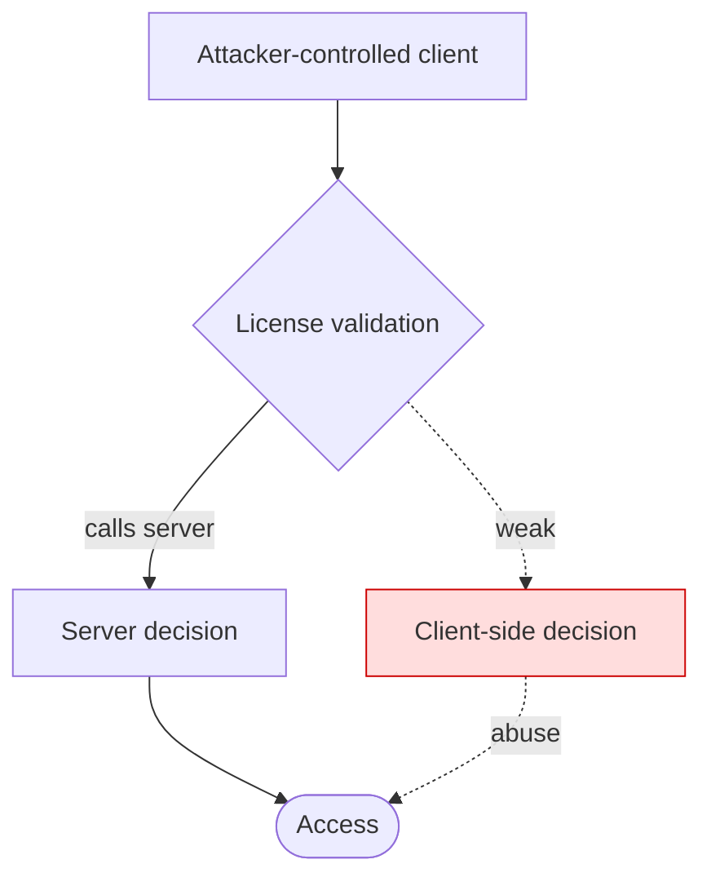

# License Attack-Path (design-level, for red-team write-up)

_Describes, at design level, why each control is abusable and the class of
technique — as findings for an authorized engagement. It is NOT a working
bypass, keygen, or patch (MASTER_POLICY §2)._

## Flow

## Weakness paths

### Client-side decision
- **Precondition:** Attacker controls the client (debugger/patched binary).
- **Technique class:** Force the non-authoritative boolean to the allow state.
- **Effect:** Access granted without a valid entitlement.
- **Control that breaks the path:** Make the server the authority; client only renders a signed decision.

## Overall
- Server-side validation: **present**.
- Priority: eliminate the highest-severity local decision points first; move authority server-side.